# slsa-pipeline-lab

A minimal supply-chain security lab. The app is a 9-line Flask API; the point is the pipeline:

**code → GitHub Actions build → SAST/SCA/secrets scans → signed evidence bound to the image digest → SLSA L3 provenance → OPA decision → mock change request (auto-approve or manual) → mock SD Elements updated by CI only → kind + Kyverno admits only images with valid provenance.**

Everything is free: public repo, GHCR, Sigstore public-good (Fulcio/Rekor), GitHub OIDC, cloudflared quick tunnel. No real secrets are stored in the repo.

## Architecture

```mermaid
flowchart LR
  dev[Developer PR] -->|branch protection: PR + 1 review + checks| main

  subgraph build["build.yml (GitHub-hosted)"]
    T[test: pytest + opa test] --> B[docker build]
    B --> S["scan: semgrep · trivy fs+image · gitleaks<br/>raw JSON → counts"]
    S --> G{"OPA build gate<br/>policy/scan_gate.rego"}
    G -->|pass, main only| P[push to GHCR<br/>capture digest]
    P --> PROV["SLSA L3 provenance<br/>slsa-github-generator (isolated reusable workflow)"]
    P --> ATT["cosign attest (keyless, GitHub OIDC)<br/>sast / sca / secrets predicates"]
  end
  main --> build

  PROV --> REG[(ghcr.io image@digest<br/>+ .att signatures)]
  ATT --> REG
  ATT -.cert + entry.-> REKOR[(Fulcio / Rekor)]

  subgraph release["release.yml (manual dispatch, digest input)"]
    V["verify: slsa-verifier + cosign verify-attestation<br/>(repo + workflow identity)"] --> E[evidence.json<br/>verified payloads only]
    E --> O{"OPA policy/release.rego"}
    O -->|auto_approve| CR
    O -->|manual| ENV[["environment: manual-approval<br/>(required reviewer)"]] --> CR
    O -->|reject| CR
    CR[POST /snow/change] --> SDE["PUT /sde/countermeasures<br/>T-SAST · T-SCA · T-SECRETS"]
    SDE --> GATE{reject? → fail run}
  end
  REG --> V

  subgraph laptop["laptop"]
    MOCKS["FastAPI mocks<br/>ServiceNow + SD Elements<br/>reconciler re-verifies with cosign"]
    subgraph kind["kind: slsa-lab"]
      KY{{"Kyverno verifyImages<br/>SLSA provenance + scan attestations"}} --> POD[pod]
    end
  end
  CR & SDE -->|cloudflared tunnel| MOCKS
  REG --> KY
```



## What enforces what

| Control | Where | Decides |
|---|---|---|
| Unit tests, policy tests, mock tests | `build.yml` → `test` | required status check |
| SAST (Semgrep `p/python`, `p/flask`), SCA (Trivy fs + image), secrets (Gitleaks) | `scripts/scan.sh` | tools always exit 0; they only *produce* JSON |
| Build gate | `policy/scan_gate.rego` + `policy/thresholds.json` | fail on **fixable** critical or any secret |
| Image → digest | `build-scan` job pushes the *same* image it scanned | |
| SLSA Build L3 provenance | `slsa-github-generator` `generator_container_slsa3.yml@v2.1.0` | |
| Scan evidence | `cosign attest --type https://slsa-pipeline-lab/attestations/{sast,sca,secrets}/v1`. Predicate: tool, version, commit, run URL, counts, fixable counts, top findings, raw-file sha256, changed paths | |
| Release verification | `scripts/verify.sh` (slsa-verifier + cosign with `--certificate-identity` / issuer / repo) → `scripts/bundle.py` | only verified payloads reach OPA |
| Release decision | `policy/release.rego` | `reject` / `manual` / `auto_approve` + reasons |
| Human approval | GitHub environment `manual-approval` (required reviewer) | |
| Mock API tokens | GitHub environment `release` (main only): `CR_TOKEN`, `SDE_CI_TOKEN` secrets, `MOCK_URL` var | |
| CI-owned countermeasures | `mocks/main.py`: only CI token may write; `/sde/reconcile` reverts anything not backed by a verified attestation | |
| Admission | `deploy/kyverno-policy.yaml` | provenance from the generator **called by this repo** on `main` + sca/secrets attestations from `build.yml@refs/heads/main` |

### Release policy (`policy/release.rego`)

* **reject:** provenance missing or failed verification; builder isn't the SLSA generator at a release tag; source repo mismatch; any required scan attestation missing or unverified; a scan attestation for a different commit than the provenance; any critical finding; any secret.
* **manual:** high findings, or changed paths under `auth/`, `payments/` or `migrations/`.
* **auto_approve:** otherwise.

Reject wins over manual. `opa test policy/ -v` runs 23 tests covering every branch, including precedence and look-alike paths.

**Policy choice: count fixable findings only (`count_unfixed: false`).** `python:3.12-slim` currently carries 49 HIGH Debian CVEs that have **no fix available**. Counting them would push every release to manual and teach people to rubber-stamp. The predicate still records the full counts, so flipping the flag is a one-line policy change.

**Changed paths are signed.** They're computed in the build (`git diff HEAD^ HEAD`, with main squash-merge-only, so one commit equals one PR) and embedded in every scan predicate. OPA therefore only sees changed paths that came from a verified attestation, never from the release caller.

## Setup

Tested on Debian 13 x86_64. For macOS (Apple Silicon), see [notes](#macos-apple-silicon).

```bash
make tools          # cosign v2.6.5, slsa-verifier v2.7.1, opa v1.21.4, trivy 0.76.1, gitleaks 8.30.1,
                    # kyverno 1.19.1, cloudflared 2026.10.3, semgrep 1.178.0. Pinned, sha256-checked
make test           # pytest (app + mocks) and opa test
make scan           # local build + the same scans and gate as CI
```

GitHub, one time (already done for `rajumandala/slsa-pipeline-lab`):

1. Create a public repo and push. Make the GHCR package **public** (Package settings → Change visibility). The API can't do this.
2. Settings: squash merge only. Branch protection on `main`: PR required, 1 approval, required checks `test` and `build-scan`, linear history, `enforce_admins=false` (see [solo reviewer](#solo-developer-second-reviewer-gap)).
3. Environments:
   * `release`: deployment branches = `main`; secrets `CR_TOKEN`, `SDE_CI_TOKEN`; variable `MOCK_URL`.
   * `manual-approval`: required reviewer = you; deployment branches = `main`.

   Generate the tokens locally into `mocks/.env.local`, which is gitignored and mode 600:
   ```bash
   umask 077; { for v in MOCK_CR_TOKEN MOCK_SDE_CI_TOKEN MOCK_SDE_DEV_TOKEN; do echo "$v=$(openssl rand -hex 24)"; done; echo MOCK_DB=mocks/mock.db; } > mocks/.env.local
   . mocks/.env.local
   printf %s "$MOCK_CR_TOKEN"     | gh secret set CR_TOKEN     --env release
   printf %s "$MOCK_SDE_CI_TOKEN" | gh secret set SDE_CI_TOKEN --env release
   ```
   The developer token never goes to GitHub.

Run a release:

```bash
make mocks                                  # terminal 1
make tunnel                                 # terminal 2; copy the https://….trycloudflare.com URL
gh variable set MOCK_URL --env release --body https://<name>.trycloudflare.com
make verify  DIGEST=sha256:...              # optional: same verification + OPA locally
make release DIGEST=sha256:...              # dispatch release.yml
```

Deploy:

```bash
make kind-up                                # kind "slsa-lab" + Kyverno + local registry + policy
make demo-good DIGEST=sha256:...            # admitted
make demo-unsigned                          # rejected
```

> With several kind clusters running you may hit `too many open files` (kube-proxy crash loop).
> Fix: `sudo sysctl -w fs.inotify.max_user_instances=512 fs.inotify.max_user_watches=524288`.

## Results captured in this repo

| Flow | Result |
|---|---|
| First main build (`1c2794b`) → `sha256:fa03832d…99c5` | test, build-scan, provenance (3 jobs), attest-scans all green ([run](https://github.com/rajumandala/slsa-pipeline-lab/actions/runs/42369307464)) |
| Local `make verify` on that digest | PASS provenance (builder `…generator_container_slsa3.yml@refs/tags/v2.1.0`, source `git+https://github.com/rajumandala/slsa-pipeline-lab`), PASS sast/sca/secrets |
| Release of that digest | **manual**: root commit "changes" `auth/`, `payments/`, `migrations/`. CR `pending_approval` → reviewer approved in environment → SDE T-SAST/T-SCA/T-SECRETS = Complete with run URL + digest → CR `approved` ([run](https://github.com/rajumandala/slsa-pipeline-lab/actions/runs/42369979707)) |
| `/sde/reconcile` after that release (real cosign against GHCR) | `{"reverted": []}` |
| Kyverno, good digest | `pod/hello created`, Ready |
| Kyverno, locally built unsigned image | denied: `image attestations verification failed … no matching attestations` |

## Break it

Each scenario fails at the control it targets. All of these were run.

### 1. Commit a secret → Gitleaks → build gate

```bash
git switch -c breakit/secret
echo "payment_api_key = \"$(openssl rand -hex 20)\"" > app/settings.py   # fake, random, generated on the spot
git commit -am "break-it: secret" && git push -u origin HEAD && gh pr create --fill
```
The `build-scan` check fails with `secrets: 1 secret(s) detected (max 0)`, so the PR can't merge. No image or attestations are produced.
Run: [PR #1](https://github.com/rajumandala/slsa-pipeline-lab/pull/1). If it were force-merged, every main build would keep failing, because main scans the full history of HEAD. Release would also `reject` (`secrets: N secret(s) found`).

> Provider-format tokens (`ghp_…`, `AKIA…`) may be stopped earlier by GitHub push protection. That's a control too, but the generic key shows the pipeline's own gate.

### 2. Vulnerable dependency → Trivy → build gate / manual

```bash
echo 'h11==0.14.0' >> requirements.in        # CVE-2025-43859, CRITICAL, fixed in 0.16.0
pip-compile --generate-hashes --strip-extras --no-header -o requirements.txt requirements.in
```
`build-scan` fails with `sca: 1 critical finding(s) (max 0)`. Run: [PR #2](https://github.com/rajumandala/slsa-pipeline-lab/pull/2).

A **high-only** fixable vulnerability (e.g. `urllib3==2.2.1`) passes the build gate by design. At release it becomes `manual` (`sca: N high finding(s) need human review`), which is covered by `test_fixable_high_is_manual`.

### 3. Unsigned image → Kyverno (and release)

```bash
make demo-unsigned      # docker build → push to local registry → kubectl apply
```
```
admission webhook "mutate.kyverno.svc-fail" denied the request:
require-slsa-and-scans: verify-provenance-and-scans: 'image attestations verification failed,
verifiedCount: 0, requiredCount: 1, error: no matching attestations'
```
Releasing a digest without attestations gives `reject`: `provenance: missing`, `sast|sca|secrets: verified scan attestation missing`.

### 4. Manual SD Elements edit → 403 / reconcile revert

```bash
make demo-sde DIGEST=sha256:fa03832d1d19642a025da0ff8813a9ebfb6126dbc2b10a6294dcb40bf50f99c5
```
This runs against an isolated mock instance and uses real cosign:
```
== 1) developer token: PUT T-SAST=Complete  -> blocked
     HTTP 403
== 2) developer edits the store directly    -> reverted
     T-SAST Complete by developer
     {"reverted":[{"id":"T-SAST","from":"Complete","to":"Incomplete",...}]}
== 3) leaked CI token + digest with no attestation -> reverted
     T-SAST Complete by ci sha256:111111111111
     {"reverted":[{"id":"T-SAST","from":"Complete","to":"Incomplete",...}]}
== 4) CI token + real attested digest -> survives reconcile
     {"reverted":[]}   T-SAST Complete by ci sha256:fa03832d1d19
== alerts
     developer tried to set T-SAST=Complete via API: denied
     ALERT T-SAST: status Complete (changed_by=developer, ...) has no matching verified attestation; reverting to Incomplete
     ALERT T-SAST: status Complete (changed_by=ci, digest=sha256:1111…) has no matching verified attestation; ...
```
The unit tests in `mocks/test_mocks.py` cover the same cases, with cosign stubbed.

## Design notes and trade-offs

* **One action isn't pinned by SHA.** Every action is pinned by commit SHA except `slsa-github-generator/.github/workflows/generator_container_slsa3.yml@v2.1.0`. slsa-verifier only trusts the generator when it's referenced by a release tag, and pinning a SHA makes verification fail. The release policy also rejects any builder ref that isn't `@refs/tags/v…`.
* **Two signing identities.** Provenance is signed by the *generator's* reusable workflow; the calling repo is checked through the certificate's `githubWorkflowRepository` extension and the provenance source URI. Scan attestations are signed by `https://github.com/rajumandala/slsa-pipeline-lab/.github/workflows/build.yml@refs/heads/main`.
* **Scanned image = pushed image.** One job builds, scans and gates, then pushes that image, so the attested digest is the scanned one.
* **cosign v2, not v3.** cosign v3 defaults to the new bundle/referrers format. v2 keeps the `.att` tags that Kyverno and slsa-generator expect today.
* **Tools are installed by `scripts/install-tools.sh`, with checksums, instead of third-party actions.** That gives CI and the laptop identical versions and avoids trusting third-party action tags, which are mutable.
* **Gitleaks scope.** PRs scan only the PR's commits (`base..head`). Main scans the full history of HEAD. Gitleaks' default (`--all`) would flag secrets from *other* branches. That happened here, and it's now fixed.
* **Reconciler trust.** The mock trusts its own `verified_status` / `verified_digest` columns. A real system would keep those in tamper-evident storage, or re-derive them from the attestations alone.

## Solo developer: second-reviewer gap

GitHub never lets a PR author approve their own PR. With one human:

* The branch protection rule requires 1 approval but has `enforce_admins=false`, so the owner merges with `gh pr merge --squash --admin`. The bypass shows in the PR timeline and audit log. **That's the documented gap: there's no independent review.**
* To close it, add a second GitHub account (or a trusted person) as collaborator and set `enforce_admins=true`. Or use a CODEOWNERS team. Optionally, turn on "prevent self-review" on the `manual-approval` environment.
* The `manual-approval` environment currently allows self-approval for the same reason.

## What was not tested locally

* GitHub-hosted runs execute on GitHub; they were triggered and checked with `gh`, not run locally.
* macOS/Apple Silicon: everything here ran on Linux x86_64. The image is built `linux/amd64` on GitHub runners.
* Cloudflare quick-tunnel URLs change on every restart. Update the `MOCK_URL` variable each time. The tunnel has no SLA.
* A real second human reviewer.
* Sigstore public-good outages (Fulcio/Rekor) would break signing and verification. They aren't simulated.
* JFrog Artifactory/AppTrust: skipped by choice; OPA is the release gate.

### Known lab shortcuts

* Kyverno's `install.yaml` isn't covered by a published checksum; it's fetched over TLS from the GitHub release.
* `--allowInsecureRegistry=true` lets the negative demo reach the plain-HTTP local registry. Never do this in a real cluster.
* `kyverno.io/v1 ClusterPolicy` is deprecated in Kyverno 1.19 in favour of `ImageValidatingPolicy`. It still works and is better documented.
* The CR's `approver` field records the dispatching actor, not the environment reviewer.

### macOS (Apple Silicon)

`brew install cosign slsa-verifier opa trivy gitleaks kyverno cloudflared semgrep kind kubectl`. cosign must be **v2.x**; if brew installs v3, download the v2.6.5 release binary instead. Use Docker Desktop or Colima for kind. The GHCR image is amd64-only; to run it in an arm64 kind node, add `platforms: linux/amd64,linux/arm64` to the build (buildx), or run the cluster under amd64 emulation.
